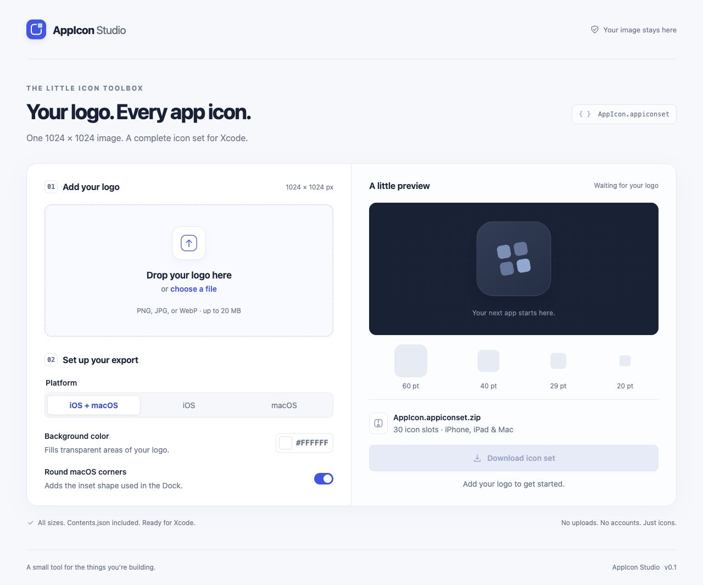

# AppIcon Studio

A small, private web tool that turns your **1024 × 1024 logo** into an Xcode-ready `AppIcon.appiconset`.

Choose a PNG, JPG, or WebP, preview the result, and download a ZIP. All image processing happens in the browser. No accounts, server uploads, analytics, external fonts, or runtime dependencies.



## Run locally

Install [Node.js](https://nodejs.org/) 22 or newer and Git, then run:

```sh
git clone https://github.com/MuhammadjonTohirov/appiconstudio.git
cd appiconstudio
npm start
```

Open <http://127.0.0.1:4173>. There is no `npm install` or build step.

Keep the terminal running while using the app. Press **Ctrl+C** in that terminal to stop it. To start it again, run `npm start` from the project folder.

To use a different port on macOS or Linux:

```sh
PORT=8080 npm start
```

Then open <http://127.0.0.1:8080>.

Alternatively, after cloning the repository and entering its folder, serve the static files with Python 3. This option does not require Node.js:

```sh
python3 -m http.server 4173 --bind 127.0.0.1 --directory dist
```

Use a current version of Safari, Chrome, Firefox, or Edge. The app uses Canvas, ImageBitmap, and CompressionStream. Serve it over HTTP locally or HTTPS when hosted; opening `index.html` directly as a file does not support its JavaScript modules reliably.

## Use the app

1. Drag a logo onto the upload area, or click **choose a file**. Use a PNG, JPG, or WebP that is exactly **1024 × 1024 pixels**, up to 20 MB.
2. Select **iOS + macOS**, **iOS**, or **macOS**. This determines which sizes go into the download.
3. Choose a **Background color** to fill transparent areas. Opaque artwork keeps its existing background.
4. Leave **Round macOS corners** enabled for an inset rounded Dock icon, or disable it for full-square artwork.
5. Inspect the large and small previews. Use the preview's platform dropdown to switch between iOS and macOS when exporting both.
6. Click **Download icon set** and unzip `AppIcon.appiconset.zip`.

To replace the source image, choose another file or drop it onto the upload area. Use the × button beside the filename to remove it. Refreshing the page clears the current image and options; nothing is saved or sent to a server.

### Add the icons to Xcode

1. Back up the project's current `AppIcon.appiconset` folder.
2. Replace that folder inside your app's `Assets.xcassets` with the downloaded `AppIcon.appiconset`. Replace the whole folder so old sizes do not remain.
3. In the app target's **Build Settings**, search for **App Icon** and set **Primary App Icon Set Name** (`ASSETCATALOG_COMPILER_APPICON_NAME`) to `AppIcon`.
4. Open the icon set in Xcode to review its slots, then build the app.

The combined export contains **30 asset slots, 29 PNG files, and `Contents.json`**:

| Platform        | Included sizes                                           |
| --------------- | -------------------------------------------------------- |
| iPhone          | 20 pt at 2×/3×; 29 pt at 1×/2×/3×; 40 and 60 pt at 2×/3× |
| iPad            | 20, 29, 40, and 76 pt at 1×/2×; 83.5 pt at 2×            |
| iOS / App Store | 1024 px universal image, shared with the marketing slot  |
| macOS           | 16, 32, 128, 256, and 512 pt at 1×/2×                    |

iOS images are explicitly encoded as RGB PNGs **without an alpha channel**. Mac images have transparent outer margins when rounding is enabled. The tool does not crop your design, synthesize dark or tinted artwork, or generate an Icon Composer `.icon` file. It exports the requested traditional asset catalog.

Format references: [Apple's asset catalog setup](https://developer.apple.com/documentation/xcode/configuring-your-app-icon) and [app icon metadata](https://developer.apple.com/library/archive/documentation/Xcode/Reference/xcode_ref-Asset_Catalog_Format/AppIconType.html).

## Development

```sh
npm test
```

Tests use Node's built-in runner. They cover slot coverage, strict source dimensions, CRC values, ZIP directory offsets, and lossless RGB PNG encoding.

```text
dist/                 Tracked source; deploy this folder as-is
  index.html          Accessible upload and preview UI
  styles.css          Responsive styles
  app.js              File lifecycle, options, previews, download
  lib/iconset.js      Apple icon slots and canvas rendering
  lib/png.js          Alpha-free RGB PNG encoder
  lib/zip.js          ZIP writer (PNG files are already compressed)
  lib/binary.js       Shared binary helpers
  lib/webmcp.js       Optional browser agent integration
tools/serve.mjs        Local static server, bound to loopback
tests/                Dependency-free format tests
```

WebMCP is feature-detected. Where available, an agent can read export readiness or change the same visible export options. These tools do not read the image, upload it, select files, or trigger downloads.

## Troubleshooting

- **Wrong image dimensions:** Export a square 1024 × 1024 version from your image editor. The app intentionally rejects other sizes instead of stretching or cropping them.
- **Unsupported or unreadable file:** Export the artwork as PNG, JPG, or WebP. SVG, HEIC, and animated formats are not supported.
- **The port is already in use:** Stop the other server, or choose another port as shown above.
- **The page opens but does not work:** Use the local HTTP server rather than double-clicking `index.html`, and try a current browser version.
- **Transparent areas appear white:** Choose a different background color. Default iOS and App Store icons are exported without transparency; rounded Mac icons retain transparent outer margins.

## Hosting

Source: [MuhammadjonTohirov/appiconstudio](https://github.com/MuhammadjonTohirov/appiconstudio).

For GitHub Pages, publish the contents of `dist/` using a Pages deployment workflow; all paths are relative, including on a repository subpath. Any static web host can serve the same folder without a build. No deployment is configured by default. The included local server is for development, not production hosting.

## License

[MIT](LICENSE). Uploaded artwork remains the property of its owner.
